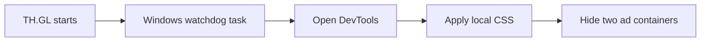

<div align="center">

# TH.GL Clean Layout

**A Windows tool that visually hides ads in TH.GL Companion.**

Hides the dashboard advertising sidebar and the bottom-right ad panel on the **AION 2 interactive map** using local CSS overrides.

<p>
  
  
  
  
</p>

</div>

> [!IMPORTANT]
> **This script hides advertisements; it does not block them.** It applies CSS to make two advertising containers invisible and reclaim their screen space. Ad requests may still occur. It does not remove advertising code, unlock TH.GL's paid ad-free features, or modify the TH.GL executable.

## What it hides

| TH.GL dashboard | AION 2 interactive map |
|:--|:--|
| **Hides the 360 px ad sidebar**, so the main content can use that space. | **Hides the bottom-right ad panel**, including the "Get AD Free" label. |
| Dashboard navigation stays available. | Map controls and live player position tracking are not changed by the CSS. |

No EXE patching, DNS blocking, browser extensions, game-memory access, or additional software installations. The tool uses **Microsoft Edge WebView2 DevTools Local Overrides** and a Windows scheduled task.

**Why PowerShell?** Windows PowerShell installs the local CSS override and creates the scheduled task that reopens/minimizes DevTools after TH.GL starts. All source code is readable in this repository; review it before running anything as administrator. No game files are patched.

## Quick start

**1.** [Download ZIP](../../archive/refs/heads/main.zip), extract it, and review the scripts.

**2.** Open **Windows PowerShell 5.1 as Administrator** in the extracted folder and run:

```powershell
powershell.exe -NoProfile -ExecutionPolicy Bypass -File .\install.ps1
```

**3.** **Do not copy or drag any files into DevTools.** The installer has already created the CSS override on your computer. DevTools only needs permission to read that folder.

Open **TH.GL > Settings > Developer Tools > dashboard**, then:

   1. In DevTools, click **Sources** (top bar).
   2. In the **left panel**, open **Overrides**. If you only see **Page** or **Workspace**, click the small **More tabs** arrow beside them and choose **Overrides**.
   3. Click **Select folder for overrides**. In the Windows folder picker, select the **folder itself** (not a CSS file):

      ```text
      Documents\THGL-Clean-Layout\        <-- SELECT THIS FOLDER
        static.th.gl\_next\static\chunks\...css  <-- created automatically
      ```

   4. Click **Select Folder** in the Windows dialog, then **Allow** when DevTools asks for access.
   5. Make sure **Local overrides** is checked. If you can see the folder name and `static.th.gl` beneath it, **you're done** for this window.

**4.** Start AION 2. Back in **TH.GL > Settings > Developer Tools**, open **aion2 (overlay)** DevTools. Repeat step 3 there, selecting **exactly the same `Documents\THGL-Clean-Layout` folder**. The dashboard and overlay are separate DevTools windows, so both require one-time folder access.

**5.** Refresh the dashboard and map once. On later launches, the Windows task reopens/minimizes DevTools automatically. Ads may remain visible briefly until the watchdog attaches and the CSS takes effect. You do **not** need to upload, paste, or move the files in the `Overrides` panel.

> [!NOTE]
> Approving the Local Overrides folder in **both** DevTools windows is a one-time manual WebView2 permission step. The installer cannot approve it for you.

> [!TIP]
> **Can't find Overrides?** In **Sources**, use the **left-side More tabs** arrow next to **Page / Workspace**, not the DevTools three-dot menu at the top-right. Widen DevTools if necessary. [Microsoft Edge DevTools guidance](https://learn.microsoft.com/en-us/microsoft-edge/devtools/sources/).
>
> **Already see a folder and checked "Local overrides"?** That window is already connected; don't try to add individual files. Verify that it points to the **folder created by this installer**. The folder shown in personal setups may have a different name (for example, `THGL-Overrides` instead of this project's default `THGL-Clean-Layout`).

## How ad hiding works



| File | Purpose |
|:--|:--|
| `install.ps1` | Downloads a current TH.GL stylesheet to a local overrides folder, appends the ad-hiding CSS, and configures autostart. |
| `watchdog.ps1` | Detects TH.GL windows, opens DevTools when needed, refreshes the views, and minimizes DevTools. |
| `clean-layout.css` | Two targeted CSS rules that hide the dashboard and AION 2 map ad containers. |

The upstream CSS is downloaded **to your computer**; this repository does not redistribute TH.GL assets. The watchdog checks roughly every 7 seconds. Its script is installed in the administrator-protected `Program Files\THGL-Clean-Layout` directory because the scheduled task may need elevated privileges.

The watchdog matches windows to TH.GL and its child processes in the current Windows session. If DevTools opens before Console is ready, it retries the unfinished refresh with a delay of 7–60 seconds. Completed refreshes are not repeated on every poll. Dashboard and overlay retries are independent. Logs rotate on startup and at approximately 2 MiB, retaining one previous log. Each session creates its own log file rather than appending through an existing filesystem link.

## Safe updates and recovery

- The manifest accepts only a single CSS file in the generated stylesheet directory. Parent traversal, unexpected files, and symbolic links/junctions in managed paths are rejected.
- New installations record SHA-256 hashes of the generated CSS and installed watchdog. If either file has been edited, update and uninstall stop rather than discarding the changes. Preserve or move the edited file before retrying. These hashes detect edits; the user-writable manifest is not an authentication mechanism.
- Existing files without a recognized manifest are not overwritten. Legacy installations are migrated with copies of their CSS and watchdog under `Documents\THGL-Clean-Layout\backups`. Those backups are intentionally retained after uninstall.
- Files are written through temporary files in the same directory. If a later operation fails, the installer attempts to restore the previous files and scheduled task. An incomplete rollback is reported explicitly. This handles caught errors; recovery after power loss or forcibly terminating PowerShell is not guaranteed.
- Uninstall reports an error if it cannot remove a managed file and retains/restores the manifest for another attempt.
- Diagnostic logs are discarded during uninstall and are not restored on rollback. Log removal unlinks files without copying their contents into recovery files.

Use a normal filesystem directory for Local Overrides. Redirected Documents paths are supported when their filesystem path contains no symbolic links or junctions. Do not bypass a rejected path by running an altered elevated script.

## Uninstall

Run this from the extracted repository in **Administrator PowerShell**:

```powershell
powershell.exe -NoProfile -ExecutionPolicy Bypass -File .\install.ps1 -Uninstall
```

This removes the project's scheduled task and generated local files. You can also disable **Local overrides** or revoke the folder permission in each DevTools window. TH.GL itself is not uninstalled or modified.

## Compatibility and limitations

- **Windows only.** Tested on one PC with TH.GL Companion **22.20.0**; not yet validated on other PCs or versions.
- **Visual hiding, not ad blocking.** Advertising requests can still be sent; the tool only changes how the two ad containers are displayed.
- TH.GL updates may change CSS filenames, DOM elements, or Developer Tools controls. Rerun the installer if a CSS filename changes; selectors may also need updating.
- DevTools must remain open (minimized is fine). The watchdog requires an unlocked interactive Windows session and may briefly reload the map when it attaches.
- The installer still requires administrator privileges. Path checks reject existing reparse points; they do not make an actively modified directory tree race-free. Do not let another process modify the installation directories during elevated install/uninstall.
- Window/process matching and focus checks reduce accidental interaction with other windows. Sending Enter still depends on desktop focus; avoid switching windows while the watchdog attaches.
- This is an **unofficial community project**, not affiliated with or endorsed by TH.GL. Check TH.GL's applicable terms before using it. Use at your own risk.

## Development and offline tests

No package installation is needed for the application. Isolated staging does not create scheduled tasks:

```powershell
powershell.exe -NoProfile -NonInteractive -File .\install.ps1 -StageOnly -InstallRoot "$env:TEMP\THGL-QA"
powershell.exe -NoProfile -NonInteractive -File .\install.ps1 -StageOnly -Uninstall -InstallRoot "$env:TEMP\THGL-QA"
```

Live staging downloads CSS from `app.th.gl` and `static.th.gl`. It does not run the watchdog or verify Windows/WebView2 behavior. `-StageOnly` also runs on PowerShell 7 for filesystem testing.

The offline installer suite needs Python 3 (standard library only) and a supplied PowerShell executable. HTTP responses and selected failures are synthetic; the real installer runs in temporary directories:

```text
python tests/test_install.py --pwsh powershell.exe
```

The watchdog suite uses inert Windows API replacements in a fresh PowerShell 7 process. It executes production function bodies without operating real windows or sending keys:

```text
pwsh -NoLogo -NoProfile -NonInteractive -File tests/Test-Watchdog.ps1
```

CI runs installer tests on Windows PowerShell 5.1 and PowerShell 7, and watchdog fixtures on PowerShell 7. Fixtures do not replace manual Windows acceptance: approve both Overrides folders, verify both views, delay/reopen DevTools, restart TH.GL, and check update/uninstall and scheduled-task recovery.

<sub>License: [MIT](LICENSE) applies to this repository's original files only.</sub>
